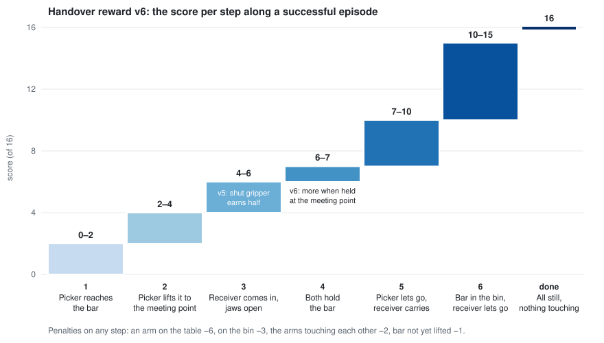

# The handover reward, from zero

Two SO-101 arms sit side by side. One of them, the **picker**, grabs a red bar (25 × 25 × 60 mm) from the table and lifts it to a meeting point in mid-air, the **handover point**. The other, the **receiver**, grips the bar's free end. The picker lets go, and the receiver carries the bar to the white bin and drops it in. Neither arm can reach both the bar and the bin, so the handover is necessary.

Nobody shows the arms how to do this. They learn by trial and error (reinforcement learning, here SAC). At every step of the simulation the environment gives one number, the **reward**, and learning slowly changes the arms' behaviour to collect more of it. Everything the arms end up doing comes from what that number pays for, so this page is about that number: what it pays, and why.



## 1. Two rules the whole design follows

**The score must rise along the path we want, and never drop along it.** The learner looks about ten steps ahead (γ = 0.9: a point ten steps away counts about a third as much as one now). If the score drops anywhere on the intended path, that spot looks like a cliff, and the arms learn to stop before it. Reward v1 had such drops between stages, and training stalled there ([reward-design §2-3](reward-design.md#2-v1s-dips)).

**Nothing off the path may pay more than the path.** The learner finds anything that pays, including things we did not mean (a shortcut). Reward v3 paid a full point more for both arms holding the bar wherever it was. Halfway through training the receiver was gripping the bar low, near the table, instead of at the meeting point ([B012](experiments/B012-v3-carry-practice.md)).

## 2. The staircase

The task is split into six stages, each owning a band of scores. Each band starts where the one before it ends, so moving to the next stage always pays more. Inside a band, a smooth term pulls toward the next stage: the closer you are, the more you get.

| Stage | When | Score | What raises it inside the band |
|---|---|---|---|
| 1 | the picker is not yet holding the bar | 0-2 | the picker's fingertips getting closer to its end of the bar |
| 2 | the picker holds the bar | 2-4 | the bar getting closer to the handover point |
| 3 | the picker holds it within 5 cm of the handover point | 4-6 | the receiver's fingertips getting closer to the bar's free end, paid in full only if its gripper is open wider than the bar (v5) |
| 4 | both hold the lifted bar | 6-7 | half: the bar being at the handover point (v6); half: the picker opening its gripper |
| 5 | handover done: the receiver holds, the picker no longer squeezes | 7-10 | +1 once the picker is off the bar; up to +2 as the bar moves toward the bin, over it and down into it |
| 6 | handover done and the bar is in the bin | 10-15 | the same +2 for position; +1 the receiver lets go; +1 its gripper opens; +1 both arms are still |
| done | the bar in the bin, still, nothing touching it or the bin, arms still | 16 | |

Penalties are subtracted on any step: −6 for an arm touching the table, −3 for the bin (not counted once the bar is in it), −2 for the two arms touching each other, and −1 for every step before the handover in which the bar is not lifted (so the picker picks it up promptly). For training, the score is divided by 16, so a step is worth between −0.75 and 1.

"Handover done" is a switch. It flips on the first step both arms hold the lifted bar, and it stays on until the episode ends. Stages 5 and 6 are only open after it, so the carry pays only for a bar that has passed through both grippers.

## 3. One episode, in numbers

These are real scores from the reward code. Each row is a constructed moment along a good episode (`experiments/bimanual/reward_probe_v6.py`):

| Moment | Score |
|---|---|
| receiver 20 cm from the bar, gripper open | 4.48 |
| same, gripper shut | 4.24 |
| receiver at the bar, open, not yet gripping (hovering) | 5.95 |
| same, gripper shut | 4.98 |
| both hold, bar at the handover point | 6.56 |
| both hold, bar 25 cm away from it | 6.13 |
| both hold, picker half open | 6.75 |
| both hold, picker fully open | 7.00 |
| handed over, one picker jaw still touching the bar | 7.71 |
| handed over, picker clear of the bar | 8.71 |
| bar over the bin and lowered into it, then let go, arms still | rising to 15 |
| success | 16 |

Read down the column: every step forward pays more than the one before. Read across the pairs: a shut gripper on the way in loses about 1 point, and holding the bar away from the meeting point loses about 0.4.

## 4. What counts as holding

A gripper "holds" the bar when both of its jaws feel at least 0.5 N from it, pushing them roughly open (the check allows up to 110 degrees off). Since B019 the jaws must also be stopped by the bar: at least 3% open. A real grip on this bar stops at 10-11% open.

The second condition exists because the first one alone accepts a fully closed gripper pressed against the bar's side. B018 found that about half the counted "handovers" were like that. Such a grip drops the bar the moment the picker lets go. Since B019, everything that pays for holding (stages 2-6, the handover switch) and every count in the experiments uses the stricter test.

## 5. How each piece got there

Each piece of the reward was added to fix a failure we saw. The failures are worth knowing, because the next change can repeat them.

| Piece | The failure it fixed | Where |
|---|---|---|
| Stages that never drop along the path (v2) | v1's score fell between stages, e.g. while the picker's jaws opened but still touched, or a released bar fell into the bin | [reward-design §2-6](reward-design.md#6-reward-v2), B008 |
| A carry pull that is the same at every distance | the old pull was flat about 30 cm from the bin, where carries start. On its own the linear pull barely moved the bar closer (B006), but v2 kept it so the carry always has a direction | [B006](experiments/B006-linear-carry.md) |
| Looking ~10 steps ahead (γ 0.9, not 0.97) | at 0.97 the handover stalled | [B011](experiments/B011-full-task-gamma-090.md) |
| The stricter grasp test | half the counted handovers were a shut gripper pressed on the bar | [B018](experiments/B018-practise-the-release.md), [B019](experiments/B019-real-grasps.md) |
| v5: the receiver's approach pays in full only with an open gripper | in 41% of episodes the receiver came in shut and pressed on the bar; v2 paid that only 0.125 less than a real approach | [B020](experiments/B020-open-approach.md) |
| v6: both holding pays more at the handover point | after v5 the receiver opened but hovered: gripping paid only 0.1 more than hovering | [B021](experiments/B021-scratch-v6.md) |

Two changes failed and were taken out:

- **v3** paid a full point more for both arms holding the bar anywhere. That made grabbing anywhere better than waiting at the meeting point (B012). v6 pays the extra only near the meeting point, fading with distance.
- **v4** changed how the picker's release was paid while training continued from a policy that already released well. Its existing releases lost value, and it unlearned them in all five runs (B016).

## 6. Rules for changing it

1. Never let the intended path drop.
2. Score the shortcuts as well as the intended path, on constructed states (B012).
3. When continuing training from a trained policy, first score that policy's own states under the old and new reward, and do not lower what it already does well (B016). Even then, continuing is fragile: in B019 it lost the release in 4 of 6 runs.
4. Set every threshold from measured data, on a seed you do not use to check it (B020: a first guess of "30% open" would have cut most real approaches, since they open to about 22%).
5. Count only real grasps (B018).

## Words and symbols

| Term | Meaning |
|---|---|
| step | one control tick of the simulation; an episode is 120 steps |
| openness | how far a gripper is open: 0 shut, 1 fully open; the bar fills the jaws at about 10.5% |
| 1 − tanh(5 d) | the smooth pull used in most stages, with d in metres: 1 at the target, 0.54 at 10 cm, 0.24 at 20 cm, near 0 beyond 40 cm |
| γ (gamma) | how much the learner discounts the future per step; 0.9 means it effectively looks about 10 steps ahead |
| handover point | the fixed meeting point in mid-air between the two arms |
| v1 ... v6 | reward versions; each is the one before with one change ([reward-design.md](reward-design.md) has the full history) |

<details>
<summary>The formula (v6), as in <code>envs/handover.py</code>, <code>compute_dense_reward</code></summary>

Distances in metres; `pull(d) = 1 − tanh(5 d)`; openness from 0 (shut) to 1.

```
stage 1   2 · pull(picker fingertips → its end of the bar)
stage 2   if the picker holds:                        2 + 2 · pull(bar → handover point)
stage 3   if it holds the bar within 5 cm of the point: 4 + 2 · pull(receiver fingertips → free end) · share
          share = 0.5 + 0.5 · min(receiver openness / 0.15, 1)
stage 4   if both hold the lifted bar:                6 + 0.5 · pull(bar → handover point) + 0.5 · picker openness
stage 5   after the handover, receiver holds, picker not squeezing (or the released bar falling into the bin):
          7 + [picker off the bar] + place
stage 6   after the handover, bar in the bin:
          10 + place + [receiver off the bar] + receiver openness + still
success   16
place     = 1.2 · near + 0.4 · height   (0-2)
            near   = 1 − min(bar's horizontal distance to the bin centre / 0.40, 1)
            height = outside the bin: 1 while the bar's lowest point is 1 cm above the walls, less below;
                     over the bin: 1 + how far it has been lowered toward the floor (up to 2)
still     = 1 − tanh(10 · both arms' joint speed)
penalties −6 · arm on table − 3 · arm on bin (unless the bar is in it) − 2 · arms touching − 1 · (bar not lifted, before the handover)
training reward = score / 16
```
Each later line overrides the earlier ones when its condition holds, which is what makes the bands a staircase.
</details>
